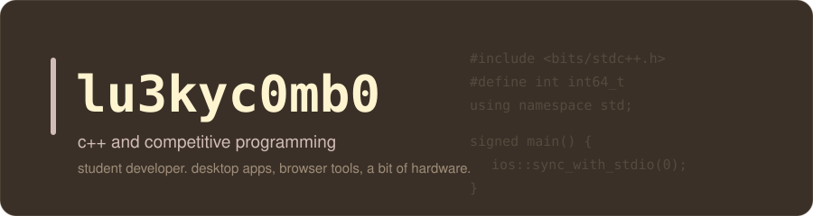
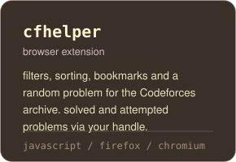
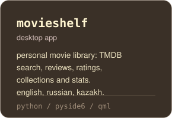
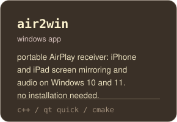
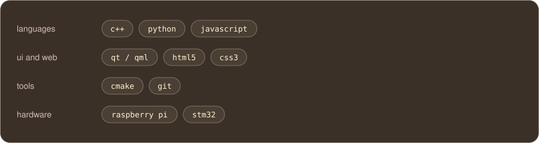

<div align="center">



<a href="https://codeforces.com/profile/lu3kyc0mb0"></a>

</div>

## projects

<table>
  <tr>
    <td width="33%"><a href="https://github.com/lu3kyc0mb0/cfhelper"></a></td>
    <td width="33%"><a href="https://github.com/lu3kyc0mb0/movieshelf"></a></td>
    <td width="33%"><a href="https://github.com/lu3kyc0mb0/air2win"></a></td>
  </tr>
</table>

## competitive programming

my main language is **C++**. usual template:

```cpp
#include <bits/stdc++.h>
#define int int64_t
using namespace std;
signed main() {
    ios::sync_with_stdio(0);
    cin.tie(0);
    cout << "hello world\n";
}
```

## tech stack




